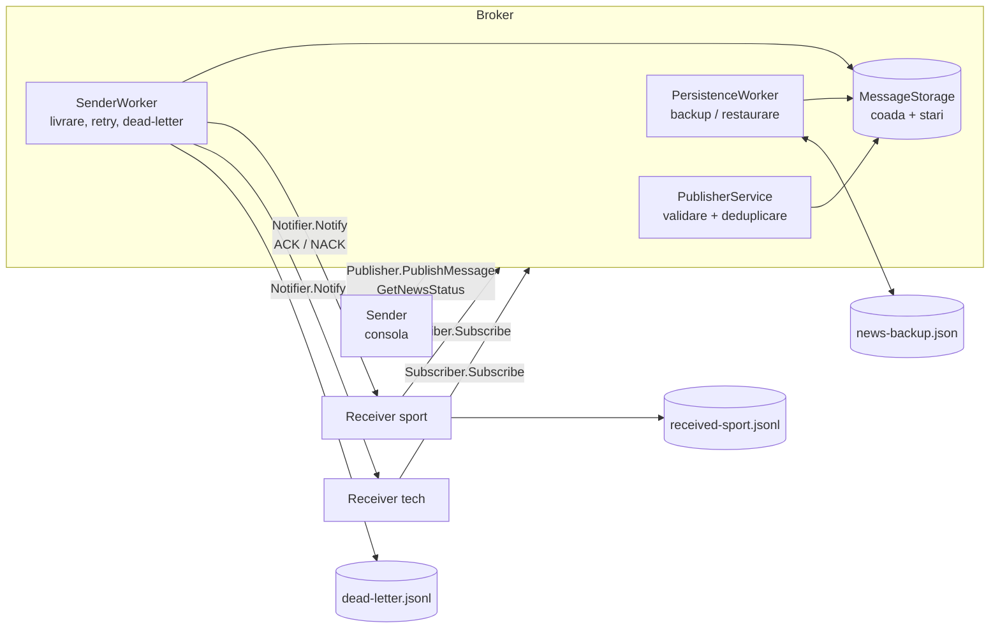
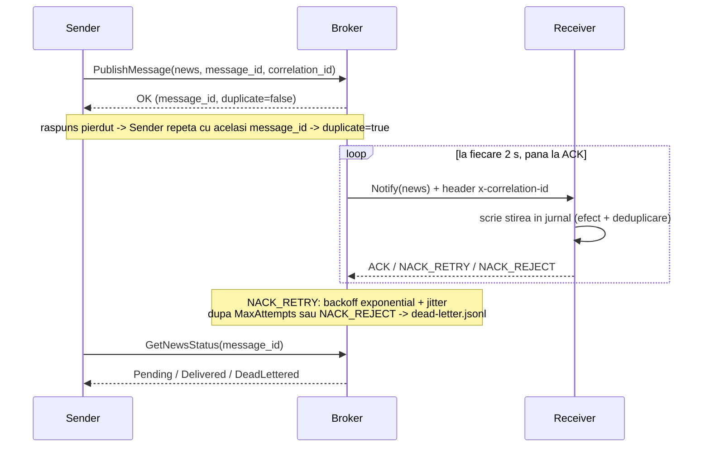

# Agent-Grpc

Agent de mesagerie (message broker) pentru stiri, realizat cu gRPC peste HTTPS.
Un **Sender** publica stiri intr-o categorie (de exemplu `sport`), **Broker**-ul
le pastreaza si le ruteaza, iar fiecare **Receiver** abonat la categoria
respectiva le primeste. Sender-ul si Receiver-ul nu se cunosc intre ei: comunica
doar cu Broker-ul (sablonul Publisher/Subscriber).

Pe langa fluxul nominal, sistemul trateaza explicit situatiile in care ceva
esueaza: raspunsuri pierdute, caderea Broker-ului, caderea unui consumator
inainte de confirmare si mesaje care nu pot fi procesate.

## Arhitectura



| Proiect | Rol |
|---|---|
| `Common` | Contractele Protobuf (`Common/Protos`), constantele contractului, politica de retry, numele evenimentelor de log. |
| `Broker` | Serviciile gRPC `Publisher` si `Subscriber`, stocarea stirilor, livrarea (`SenderWorker`), persistenta (`PersistenceWorker`), health checks. |
| `Sender` | Aplicatie de consola care publica stiri si interogheaza starea lor. |
| `Receiver` | Se aboneaza la o categorie, expune serviciul `Notifier`, scrie stirile primite in jurnal si le afiseaza. |
| `Broker.Tests`, `Receiver.Tests` | Teste unitare, de contract, de integrare si pentru scenariile de esec. |

### Fluxul unei stiri



## Contractul (`Common/Protos`, pachetul `agent.v1`)

Fiecare stire (`News`, `news.proto`) contine plicul comun:

| Camp | Semnificatie |
|---|---|
| `message_id` | GUID generat de Sender; identificator stabil si cheie de idempotenta. |
| `correlation_id` | Generat de Sender, propagat neschimbat de toate componentele si in header-ul `x-correlation-id`. |
| `message_type` | `news.published`. |
| `schema_version` | `1`. |
| `occurred_at` | Momentul acceptarii de catre Broker, UTC. |
| `category`, `title`, `content` | Continutul stirii; `category` este cheia de rutare. |
| `is_persistent` | `true`: stirea este salvata pe disc si supravietuieste repornirii Broker-ului. |

Servicii:

- `Publisher.PublishMessage`, `Publisher.GetNewsStatus` (`publish.proto`)
- `Subscriber.Subscribe` (`subscribe.proto`)
- `Notifier.Notify` (`notify.proto`), implementat de Receiver; raspunde cu `AckStatus`

Semantica erorilor la publicare face parte din contract:

| Cod gRPC | Cand | Se reincearca? |
|---|---|---|
| `INVALID_ARGUMENT` | campuri lipsa, `message_id` care nu este GUID, `message_type` gresit | nu |
| `FAILED_PRECONDITION` | `schema_version` nesuportata | nu |
| `ALREADY_EXISTS` | `message_id` refolosit pentru o stire cu alt continut | nu |
| `UNAVAILABLE`, `DEADLINE_EXCEEDED` | Broker indisponibil sau lent | da, cu acelasi `message_id` |

Reguli de compatibilitate: numerele campurilor nu se schimba si nu se refolosesc,
campurile noi primesc numere noi, iar consumatorii ignora campurile necunoscute
(Broker-ul le pastreaza si le transmite mai departe). O schimbare incompatibila
inseamna pachetul `agent.v2`. Regulile sunt verificate de `ContractTests`.

## Garantii si limite

| Garantie | Mecanism |
|---|---|
| Livrare cel putin o data | Broker-ul pastreaza stirea pana la ACK. |
| Efect aplicat o singura data la consumator | Jurnalul Receiver-ului este si efectul, si evidenta stirilor procesate. |
| Publicare idempotenta | Deduplicare dupa `message_id` (fereastra de o ora). |
| Nicio reincercare infinita | Sender: maximum 4 incercari. Broker: `Delivery:MaxAttempts` (implicit 5), apoi dead-letter. |
| Deadline explicit la fiecare apel | 5 s pentru publicare, abonare si notificare. |
| Stirile persistente supravietuiesc repornirii | Backup la 5 s, restaurat la pornire. |

Limite cunoscute:

- Stirile persistente primite in ultimele cel mult 5 s inainte de o cadere se
  pot pierde. Stirile tranzitorii se pierd la orice repornire a Broker-ului.
- Abonamentele sunt doar in memorie: dupa repornirea Broker-ului, Receiver-ii
  trebuie reporniti.
- O stire este considerata livrata cand cel putin un abonat al categoriei a
  confirmat-o.
- Ordinea nu este garantata dupa reincercari (`occurred_at` permite sortarea).
- Deduplicarea din Broker este doar in memorie; dupa repornire, duplicatul este
  oprit de jurnalul Receiver-ului.
- Certificatul HTTPS de dezvoltare este valabil doar pentru `localhost`.

Detalii si justificari: [docs/adr](docs/adr).

## Cerinte

- .NET SDK 8.0 sau mai nou (proiectele tintesc `net8.0`).
- Certificatul HTTPS de dezvoltare .NET, de incredere (o singura data pe calculator):

  ```powershell
  dotnet dev-certs https --trust
  ```

## Compilare si teste

```powershell
git clone https://github.com/patriciabajureanu/Agent-Grpc.git
cd Agent-Grpc
dotnet build "Agent Grpc.sln"
dotnet test "Agent Grpc.sln"
```

Testele pornesc Broker-ul si Receiver-ul in proces si nu au nevoie de porturi
libere sau de certificat. GitHub Actions ruleaza compilarea (cu avertismentele
tratate ca erori) si testele la fiecare push si pull request.

## Rulare locala

Trei terminale, in directorul repository-ului, pornite in ordinea urmatoare:

1. Broker:

   ```powershell
   dotnet run --project Broker --no-launch-profile
   ```

   Verificare: <https://localhost:5001/health/ready> raspunde `Healthy`.

2. Receiver (se pot porni mai multe, pe categorii diferite):

   ```powershell
   dotnet run --project Receiver --no-launch-profile
   ```

   Introdu categoria, de exemplu `sport`, si asteapta `Subscribed reply: True`.
   Stirile primite apar in consola si in `Receiver/received-sport.jsonl`.

3. Sender:

   ```powershell
   dotnet run --project Sender 2> sender.log
   ```

   Introdu categoria, titlul, continutul si `y` daca stirea este persistenta.
   Sender afiseaza `Published news <id>`. Comanda `status`, urmata de id,
   afiseaza starea stirii (`Pending`, `Delivered`, `DeadLettered`). Log-urile
   JSON ale Sender-ului merg pe stderr (aici in `sender.log`).

Scenariile de esec (Broker oprit fortat, consumator care esueaza, raspuns
pierdut) se reproduc dupa pasii din [docs/failure-scenarios.md](docs/failure-scenarios.md).

## Rulare pe doua calculatoare

Exemplu: calculatorul A ruleaza Broker si Sender, calculatorul B ruleaza
Receiver. Ambele sunt in aceeasi retea; `IP_A` si `IP_B` sunt adresele lor
(`ipconfig`). Certificatul de dezvoltare este valabil doar pentru `localhost`,
deci fiecare calculator foloseste un certificat creat pentru IP-ul lui.

1. Certificatele (in directorul repository-ului):

   ```powershell
   # pe A
   powershell -ExecutionPolicy Bypass -File scripts\New-LanCertificate.ps1 -IpAddress IP_A -Name broker
   # pe B
   powershell -ExecutionPolicy Bypass -File scripts\New-LanCertificate.ps1 -IpAddress IP_B -Name receiver
   ```

   Copiaza `certs\broker.cer` pe B si `certs\receiver.cer` pe A. Pe A se
   importa `broker.cer` si `receiver.cer`, pe B doar `broker.cer`
   (Windows cere confirmare):

   ```powershell
   Import-Certificate -FilePath certs\broker.cer -CertStoreLocation Cert:\CurrentUser\Root
   ```

2. Firewall (PowerShell ca Administrator): pe A portul 5001, pe B portul 5002.

   ```powershell
   New-NetFirewallRule -DisplayName "Agent-Grpc" -Direction Inbound -Protocol TCP -LocalPort 5001 -Action Allow
   ```

3. Pe A, Broker-ul (asculta pe toate interfetele):

   ```powershell
   $env:BROKER_ADDRESS = "https://0.0.0.0:5001"
   $env:Kestrel__Certificates__Default__Path = "$PWD\certs\broker.pfx"
   $env:Kestrel__Certificates__Default__Password = "agent-grpc"
   dotnet run --project Broker --no-launch-profile
   ```

   Verificare de pe B: `https://IP_A:5001/health/ready` raspunde `Healthy`.

4. Pe B, Receiver-ul:

   ```powershell
   $env:BROKER_ADDRESS = "https://IP_A:5001"
   $env:RECEIVER_URLS = "https://0.0.0.0:5002"
   $env:RECEIVER_PUBLIC_ADDRESS = "https://IP_B:5002"
   $env:Kestrel__Certificates__Default__Path = "$PWD\certs\receiver.pfx"
   $env:Kestrel__Certificates__Default__Password = "agent-grpc"
   dotnet run --project Receiver --no-launch-profile
   ```

5. Pe A, Sender-ul se conecteaza local, ca de obicei:
   `dotnet run --project Sender 2> sender.log`.

## Configurare

Valorile implicite sunt in `Broker/appsettings.json`. `dotnet run --project` porneste procesul
in directorul proiectului, deci `news-backup.json` si `dead-letter.jsonl` apar in
`Broker/`, iar `received-*.jsonl` in `Receiver/`. Toate sunt excluse din git. Toate pot fi schimbate
prin variabile de mediu, fara recompilare; lista completa este in
[.env.example](.env.example).

| Variabila | Implicit | Efect |
|---|---|---|
| `BROKER_ADDRESS` | `https://localhost:5001` | Adresa Broker-ului |
| `RECEIVER_JOURNAL` | `received-<categorie>.jsonl` | Jurnalul Receiver-ului |
| `Persistence__IntervalSeconds` | `5` | Intervalul backup-ului |
| `Delivery__MaxAttempts` | `5` | Incercari de livrare inainte de dead-letter |
| `Delivery__BaseDelayMs` / `Delivery__MaxDelayMs` | `1000` / `30000` | Backoff-ul intre incercari |
| `Delivery__DeadLetterPath` | `dead-letter.jsonl` | Fisierul dead-letter |

Proiectul nu foloseste secrete; certificatul HTTPS se afla in magazinul de
certificate al utilizatorului.

## Health checks

| Endpoint | Raspuns |
|---|---|
| `GET /health/live` | `Healthy` cat timp procesul raspunde. |
| `GET /health/ready` | `Unhealthy` cat timp backup-ul este restaurat, `Degraded` daca backup-ul nu poate fi scris, altfel `Healthy`. |

## Log-uri

Broker, Receiver si Sender scriu cate o linie JSON per eveniment, cu:
`Timestamp` (UTC), `LogLevel`, `Category` (componenta), `EventId`, `Message`,
campurile structurate (`Result`, `DurationMs`, `Subscriber`, ...) si, in
`Scopes`, `CorrelationId` si `MessageId`. Dupa `CorrelationId` se poate urmari
aceeasi stire in toate componentele.

| EventId | Eveniment | | EventId | Eveniment |
|---|---|---|---|---|
| 1001 | `news.accepted` | | 1303 | `backup.restored` |
| 1002 | `news.duplicate` | | 1304 | `backup.corrupt` |
| 1003 | `news.rejected` | | 1401 | `news.received` |
| 1101 | `subscriber.added` | | 1402 | `news.received_duplicate` |
| 1102 | `subscriber.removed` | | 1403 | `news.received_rejected` |
| 1201 | `news.notified` | | 1404 | `journal.unavailable` |
| 1202 | `news.delivery_failed` | | 1501 | `publish.succeeded` |
| 1203 | `news.dead_lettered` | | 1502 | `publish.retry` |
| 1302 | `backup.failed` | | 1503 | `publish.failed` |

## Structura repository-ului

```text
Common/Protos/        contractele agent.v1 (news, publish, subscribe, notify, broker_storage)
Broker/Services/      PublisherService, SubscriberService, SenderWorker, PersistenceWorker, health check
Broker/Models/        Connection, StoredNews
Receiver/Services/    NotificationService, NewsJournal
Sender/Program.cs     publicare cu retry, comanda status
Broker.Tests/         teste de contract, stocare, retry, persistenta, integrare
Receiver.Tests/       teste pentru jurnalul de deduplicare
docs/adr/             deciziile arhitecturale
docs/failure-scenarios.md   scenariile de esec, cu dovezi
```
